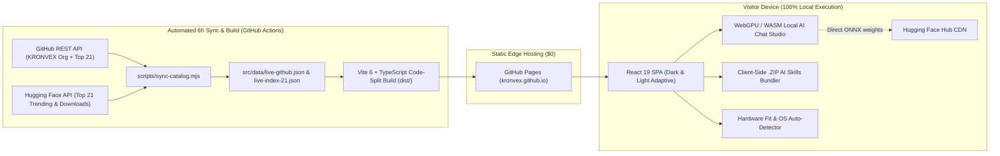

<p align="center">
  <a href="https://kronvex.github.io">
    <picture>
      <source media="(prefers-color-scheme: dark)" srcset="https://raw.githubusercontent.com/KRONVEX/.github/main/assets/hero_command_dark.svg">
      
    </picture>
  </a>
</p>

<h1 align="center">KRONVEX — Official Web Platform (<code>kronvex.github.io</code>)</h1>

<p align="center">
  <i>100% static, zero-server-cost, local-first deep-tech platform for <a href="https://github.com/KRONVEX"><b>KRONVEX</b></a> — distributing Cross-Platform Apps, Market Intelligence, AI Agent Skills, and In-Browser WebGPU AI Models.</i>
</p>

<p align="center">
  <a href="https://kronvex.github.io">
    
  </a>
  <a href="https://github.com/KRONVEX">
    
  </a>
  <a href="https://github.com/KRONVEX/KRONVEX.github.io/releases/latest">
    
  </a>
</p>

<p align="center">
  <a href="https://github.com/KRONVEX/KRONVEX.github.io/actions/workflows/deploy-pages.yml">
    
  </a>
  
  
  
  
  
</p>

<p align="center">
  
  
  
</p>

---

## Overview

**[kronvex.github.io](https://kronvex.github.io)** is the official web command center of the **[KRONVEX](https://github.com/KRONVEX)** organization:

> **Building cross-platform apps, market intelligence, and mission-critical AI to solve complex real-world problems.**

Engineered on a **zero-backend, local-first philosophy**, the platform eliminates cloud lock-in, API key bottlenecks, and recurring server overhead:

- **Direct Distribution:** Windows (`.exe`, `.msi`, `.zip`) and Android (`.apk`) builds are delivered directly from GitHub Releases CDN with SHA-256 verification.
- **On-Device AI Execution:** Compact quantized ONNX models download directly into the visitor's browser cache via `@huggingface/transformers` and run locally on **WebGPU** or **WebAssembly (WASM)** at **$0 server cost**.
- **Native 6-Language i18n + RTL:** Modular, lazy-loaded internationalization (**English, العربية RTL, Français, Español, Deutsch, 简体中文**) powered by an Antigravity-style switcher — zero third-party translation widgets and zero bundle bloat on `/`.
- **Automated Live Intelligence:** Scheduled GitHub Actions synchronize KRONVEX repositories, releases, and global **Top 21** GitHub, Hugging Face AI, and Daily Research Papers leaderboards every 6 hours into static JSON payloads.
- **Open Editorial Full-Width Visual Identity:** Card-free `max-w-[1560px]` editorial layout, pure high-contrast typography, global **Neon Green** atmospheric glow across Light & Dark modes, continuous 60fps `KronvexSignalField`, and a free-floating coded SVG Owl Crest (`KronvexLivingEmblem`).
- **Agent-Native Discoverability:** Ships with standard `robots.txt`, `sitemap.xml`, `llms.txt`, and `/.well-known/ard.json` (Agentic Resource Discovery) manifests out of the box.

---

## Zero-Server Platform Architecture



---

## Platform Modules & Routes

| Route | Module | Key Engineering Capabilities |
| :--- | :--- | :--- |
| **`/`** | **Mission Control Home** | Auto-detected client OS download CTA, live hardware/org telemetry strip, Three-Pillar architecture overview, and reactive coded SVG Owl Crest (`KronvexLivingEmblem`) coupled to the global `KronvexSignalField`. |
| **`/apps`** | **Android & Windows Apps Storefront** | Platform filters (Windows / Android / Cross-Platform), OS-recommended artifact highlighting, direct GitHub Releases links, and 1-click SHA-256 checksum copying. |
| **`/models`** | **AI Models Hub & Local Chat Studio** | Live Hardware Fit Detector (CPU threads, RAM estimate, WebGPU adapter), verified Hugging Face GGUF/ONNX/Safetensors weights across all 7 models, copyable `ollama` / `llama.cpp` / Python snippets, and **100% In-Browser Neural Chat** (`?tab=chat`) with Markdown transcript export. |
| **`/skills`** | **AI Skills Marketplace & Bundler** | Searchable catalog of `SKILL.md` agent workflows for Antigravity, Claude Code, Cursor & Gemini CLI, interactive Markdown inspector modal, and in-browser multi-skill `.zip` composer (`JSZip`). |
| **`/top-21`** & **`/research`** | **Top 21 Radar & Research Papers** | Weekly GitHub breakouts, **All-Time Most Starred**, **All-Time Most Downloaded** GitHub Releases, Hugging Face Weekly/30D/All-Time AI models, plus **Top 21 Research Papers** (21 verified arXiv landmark papers from Google/DeepMind, OpenAI, Anthropic, DeepSeek, NVIDIA, Microsoft, Samsung AI, MIT, Meta AI, Stanford, Apple & Alibaba Qwen + live **Hugging Face Daily Papers** with 1-click BibTeX & PDF). |
| **`/arcade`** | **KRONVEX Arcade (3 Games)** | **Tech & AI Mastery Arena** (45 trilingual **EN / FR / AR** Python, JS/TS & AI/LLM/RAG/DeepMind challenges + Code Labs, 3 modes, lifelines & XP ranks) · **Neural Chess** (full-stage + Fullscreen SVG board, FIDE rules, Alpha-Beta local AI across 3 tiers & 2P) · **Orbital Defender** (60fps Canvas core defense, Combo & EMP Pulse). |
| **`/constellation`** | **Ecosystem Constellation** | 60fps HTML5 Canvas orbital neural graph connecting KRONVEX pillars, apps, AI models, and skills, paired with a mobile touch node directory and slide-over Mission Dossier. |
| **`/enterprise`** | **Enterprise & Custom Engineering** | Tailored B2B software, private AI/RAG systems, market data pipelines, Lighthouse/security audits, industry breakdown, and an interactive Project Scope Builder linked directly to `/contact`. |
| **`/vision`** | **Vision, Mission & Roadmap** | Organization manifesto, local-first engineering principles, four-phase strategic roadmap, and leadership profile. |
| **`/contact`** | **Zero-Tracking Contact** | Direct GitHub organization channels, `SECURITY.md` disclosure links, and a 100% client-side structured inquiry composer (GitHub Issue pre-fill or clipboard export). |
| **`Ctrl+K`** | **KRONVEX OS Palette & CLI** | Instant global search across pages, apps, models, skills, and arcade games, plus an interactive `kronvex>` terminal (`help`, `status`, `hardware`, `apps`, `models`, `skills`, `open <page>`, `whoami`). |

---

## Verified Lighthouse 100/100 Engineering

Every production build is engineered and audited against **Google Lighthouse** on both **Mobile** and **Desktop** viewports:

| Audit Category | Mobile | Desktop | Engineering Implementation |
| :--- | :---: | :---: | :--- |
| **Performance** | **`100`** | **`100`** | Route-level `React.lazy` code splitting (`JSZip` & `Top 21` loaded on demand), 96% smaller `WebP` logos (`817 KB → 35 KB / 4.7 KB`), non-render-blocking Google Fonts (`preload`), and `fetchPriority="high"` hero assets. |
| **Accessibility** | **`100`** | **`100`** | High-contrast dark & light design tokens, semantic landmarks, keyboard shortcuts (`Ctrl+K` / `Esc`), explicit `aria-label` controls, and responsive touch targets. |
| **Best Practices** | **`100`** | **`100`** | Zero runtime console errors, strict TypeScript (`tsc -b`), clean SPA routing fallback (`404.html`), and zero third-party tracking scripts. |
| **SEO** | **`100`** | **`100`** | Canonical URL, OpenGraph metadata, valid [`public/robots.txt`](public/robots.txt), and structured [`public/sitemap.xml`](public/sitemap.xml). |
| **Agentic Browsing** | **`100`** | **`100`** | Valid [`public/llms.txt`](public/llms.txt) knowledge index and compliant [`public/.well-known/ard.json`](public/.well-known/ard.json) Agentic Resource Discovery manifest. |

---

## Repository Structure

```text
KRONVEX.github.io/
├── .github/
│   └── workflows/
│       └── deploy-pages.yml            # CI/CD: 6h data sync, production build & GitHub Pages deploy
├── public/
│   ├── .well-known/
│   │   └── ard.json                    # Agentic Resource Discovery (ARD) v1 manifest
│   ├── 404.html                        # GitHub Pages SPA deep-route redirect handler
│   ├── CNAME.example                   # Custom domain template (rename to CNAME to enable)
│   ├── kronvex-logo-512.webp           # Optimized 512px WebP hero crest (35 KB)
│   ├── kronvex-logo-96.webp            # Optimized 96px WebP navbar/footer crest (4.7 KB)
│   ├── kronvex-logo-96.png             # Crisp PNG browser favicon
│   ├── kronvex-logo.png                # 512px PNG OpenGraph fallback
│   ├── llms.txt                        # LLM & AI agent site map (llmstxt.org standard)
│   ├── robots.txt                      # Search crawler directives & sitemap pointer
│   └── sitemap.xml                     # Full XML sitemap for all platform routes
├── scripts/
│   ├── sync-catalog.mjs                # Pulls live KRONVEX repos/releases & Global Top 21 feeds
│   └── postbuild-gh-pages.mjs          # Emits dist/.nojekyll for GitHub Pages static serving
├── src/
│   ├── components/
│   │   ├── CommandTerminal.tsx         # Ctrl+K Quick Search & interactive kronvex> CLI
│   │   ├── ConstellationCanvas.tsx     # 60fps interactive orbital graph + mobile node directory
│   │   ├── Footer.tsx                  # 4-column Anthropic-style executive Mega-Footer
│   │   ├── KronvexLivingEmblem.tsx     # Reactive 3-Pillar Coded SVG Owl Crest (eye tracking, 3D tilt, 7-node pulse)
│   │   ├── KronvexSignalField.tsx      # Global continuous 60fps Hybrid Magnetic Flow & Neural Signal Canvas
│   │   ├── LanguageSwitcher.tsx        # Native Antigravity-style 6-language switcher (EN/AR/FR/ES/DE/ZH-CN)
│   │   ├── LocalAiChat.tsx             # WebGPU/WASM in-browser AI chat (@huggingface/transformers)
│   │   ├── Navbar.tsx                  # Single-line sticky navigation, i18n switcher, theme toggle & mobile drawer
│   │   ├── NeuralChessGame.tsx         # Interactive SVG chessboard, 3-tier AI, 2-Player & Fullscreen mode
│   │   ├── OrbitalDefenderGame.tsx     # 60fps HTML5 Canvas defense game with EMP Pulse & Web Audio SFX
│   │   └── TechQuizArena.tsx           # Trilingual (EN/FR/AR) Python, JS & AI/LLM/RAG/DeepMind Quiz Arena
│   ├── data/
│   │   ├── catalog.ts                  # Pillars, apps, AI models, SKILL.md modules & roadmap
│   │   ├── live-github.json            # Auto-synced KRONVEX org repository & release telemetry
│   │   ├── live-index-21.json          # Auto-synced weekly & all-time GitHub/HF Top 21 snapshot
│   │   └── techQuizBank.ts             # 45 trilingual (EN/FR/AR) Python, JS/TS & AI/DeepMind questions
│   ├── i18n/
│   │   ├── I18nContext.tsx             # Lazy-loaded React i18n provider with RTL & localStorage persistence
│   │   ├── types.ts                    # Strict TranslationSchema & LOCALE_OPTIONS registry
│   │   └── locales/                    # Modular 1-file-per-language dictionaries (en, ar, fr, es, de, zh-CN)
│   ├── pages/
│   │   ├── HomePage.tsx                # Mission Control landing page (eagerly loaded)
│   │   ├── AppsPage.tsx                # Windows & Android storefront (lazy-loaded)
│   │   ├── ArcadePage.tsx              # Tech & AI Quiz, Neural Chess & Orbital Defender hub (lazy-loaded)
│   │   ├── ModelsPage.tsx              # AI models catalog & chat studio switcher (lazy-loaded)
│   │   ├── SkillsPage.tsx              # AI skills marketplace & JSZip bundler (lazy-loaded)
│   │   ├── Index21Page.tsx             # Weekly & all-time Top 21 live leaderboard (lazy-loaded)
│   │   ├── ConstellationPage.tsx       # Ecosystem Constellation view (lazy-loaded)
│   │   ├── EnterprisePage.tsx          # Custom B2B engineering, industries & scope builder (lazy-loaded)
│   │   ├── VisionPage.tsx              # Manifesto & strategic roadmap (lazy-loaded)
│   │   └── ContactPage.tsx             # Zero-tracking inquiry composer with URL pre-fill (lazy-loaded)
│   ├── types/
│   │   └── kronvex.ts                  # Strict TypeScript domain models & hardware profile types
│   ├── utils/
│   │   ├── chessEngine.ts              # Full FIDE chess engine + Alpha-Beta & Quiescence local AI
│   │   └── hardware.ts                 # Client OS, CPU, RAM & WebGPU adapter fit evaluator
│   ├── App.tsx                         # Router, lazy route boundaries, theme & command controller
│   ├── index.css                       # Tailwind layers, glass tokens & blueprint grid styles
│   └── main.tsx                        # React 19 entry point
├── index.html                          # Preloaded WebP/fonts, SEO/ARD metadata & SPA route restore
├── package.json                        # Scripts & dependencies
├── tailwind.config.js                  # Typography & theme extension config
├── tsconfig.json                       # Strict TypeScript compiler configuration
└── vite.config.ts                      # Production chunking & GitHub Pages base path config
```

---

## Local Development & CLI Scripts

### Prerequisites
- **Node.js 20+** (Node.js 22 recommended — matches CI)
- **npm 10+**

### Commands

```bash
# 1. Install dependencies
npm install

# 2. Start local Vite development server with HMR
npm run dev

# 3. Sync live KRONVEX repos, releases & Global Top 21 snapshots
npm run sync

# 4. Type-check, build optimized production bundle & generate dist/.nojekyll
npm run build

# 5. Preview the production dist/ bundle locally
npm run preview
```

### Environment Variables

| Variable | Default | Purpose |
| :--- | :--- | :--- |
| `ORG_NAME` | `KRONVEX` | Target GitHub organization synced by `scripts/sync-catalog.mjs`. |
| `GITHUB_TOKEN` / `ORG_ACCESS_TOKEN` | *(optional)* | GitHub API token for higher rate limits during `npm run sync`. |
| `VITE_BASE_PATH` | `/` | Base public path (`/` for root GitHub Pages `kronvex.github.io` and custom domains; override for subpath deployments). |

---

## Deployment & Custom Domain

Deployment is fully automated via [`.github/workflows/deploy-pages.yml`](.github/workflows/deploy-pages.yml):

1. Every push to **`main`**, every **6-hour cron schedule (`0 */6 * * *`)**, or any manual **`workflow_dispatch`** run executes `npm ci → npm run sync → npm run build`.
2. The compiled static artifact (`./dist`) is published automatically to **GitHub Pages** (`https://kronvex.github.io`) via `actions/deploy-pages@v4`.
3. **Custom Domain (`CNAME`):** Rename [`public/CNAME.example`](public/CNAME.example) to `public/CNAME`, replace the placeholder with your domain (e.g., `kronvex.ai`), configure your DNS `A`/`CNAME` records, and enable **Enforce HTTPS** in repository Pages settings.

---

## Governance, Security & Leadership

This repository inherits all organization-wide engineering and community health policies from **[KRONVEX/.github](https://github.com/KRONVEX/.github)**:

- **Security Policy:** [SECURITY.md](https://github.com/KRONVEX/.github/blob/main/SECURITY.md) — Private vulnerability disclosure with a 48-hour acknowledgment SLA.
- **Contributing Guide:** [CONTRIBUTING.md](https://github.com/KRONVEX/.github/blob/main/CONTRIBUTING.md) — Branching, conventional commits, and verification standards.
- **Code of Conduct:** [CODE_OF_CONDUCT.md](https://github.com/KRONVEX/.github/blob/main/CODE_OF_CONDUCT.md) — Respectful, high-rigor engineering standards.
- **Founder & Lead Architect:** **[@khalid-naami](https://github.com/khalid-naami)** · [khalidnaami.com](https://khalidnaami.com) · [khalidnaami66@gmail.com](mailto:khalidnaami66@gmail.com)

---

<p align="center">
  <b>KRONVEX</b> — <i>Engineered for real-world complexity. Built to endure.</i>
</p>
